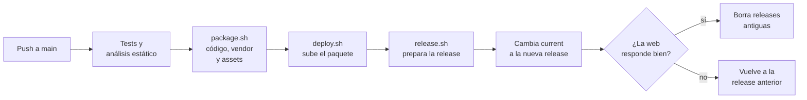

# Despliegues atómicos de Laravel con rollback automático

## Introducción {#intro}

En el tutorial [Despliegues con Laravel y AWS](/tutorials/es/laravel_aws) conté cómo sacar la compilación del front del servidor para que los despliegues con Laravel Forge fueran más rápidos.
Este tutorial va un paso más allá: un sistema de despliegue propio, con unos pocos scripts de bash, que no necesita Forge ni Envoyer.

[Talent Battles](https://talentbattles.com) vive en un VPS con [CloudPanel](https://www.cloudpanel.io/), junto a otras webs. Cada push a `main` acaba en producción así:



Lo que se consigue:

- **Sin cortes.** La nueva versión se prepara aparte y entra en producción de golpe, en un único cambio de enlace.
- **Un servidor que solo necesita PHP.** Ni Composer, ni Node.js, ni acceso al repositorio. Todo se compila en GitHub Actions.
- **Vuelta atrás automática.** Después de cada despliegue se comprueba la web, y si no responde como debe, se vuelve a la versión anterior sin que nadie tenga que hacer nada.

### El porqué de este tutorial

Un despliegue "clásico" hace `git pull`, `composer install`, `yarn build` y `migrate` directamente en la carpeta que está sirviendo la web. Mientras dura, la web está a medias: código nuevo con dependencias viejas, o assets que aún no existen.
Y si algo falla a mitad, se queda así.

La idea de los despliegues atómicos (la que usan [Envoyer](https://envoyer.io/) o [Deployer](https://deployer.org/)) es preparar cada versión en su propia carpeta y, cuando está lista, apuntar la web a ella. Es más sencillo de lo que parece, y montarlo a mano te permite entender cada pieza.

## Requisitos {#requirements}

- Una aplicación [Laravel](https://laravel.com/) en un repositorio de [GitHub](https://github.com/). Uso Laravel 13 con PHP 8.4.
- Un servidor con acceso por SSH, PHP, Nginx y `rsync`.
- [GitHub Actions](https://github.com/features/actions) para los tests, el paquete y el despliegue.
- Conocimientos básicos de bash.

## La estructura en el servidor {#structure}

Todo gira alrededor de tres carpetas:

```text
/home/mi-usuario/htdocs/mi-web.com
├── current -> releases/20261106170000-a1b2c3d   La release que está en producción
├── releases                                     Las últimas 5 releases
│   ├── 20261105120000-9f8e7d6
│   └── 20261106170000-a1b2c3d
└── shared                                       Lo que sobrevive entre releases
    ├── .env
    └── storage
```

- **`releases/`**: cada despliegue crea una carpeta nueva con el código completo. El nombre es la fecha en UTC y el commit, así que ordenarlas alfabéticamente es ordenarlas por fecha.
- **`shared/`**: el `.env` y `storage/` (logs, ficheros subidos, sesiones, caché). Cada release los enlaza, así que no se pierden al desplegar.
- **`current`**: un enlace simbólico a la release activa. Nginx sirve `current/public`.

Desplegar es, al final, cambiar a dónde apunta `current`.

### Nginx: `$realpath_root`

Hay un detalle de Nginx que es imprescindible. En el bloque de PHP, cambia `$document_root` por `$realpath_root`:

```nginx
fastcgi_param SCRIPT_FILENAME $realpath_root$fastcgi_script_name;
```

Con `$document_root`, PHP-FPM recibe la ruta del enlace: `/.../current/public/index.php`. Como la ruta no cambia entre despliegues, OPcache y la caché de rutas de PHP pueden seguir sirviendo el código de la release anterior hasta que reinicies PHP-FPM.

Con `$realpath_root`, Nginx resuelve el enlace y le pasa la ruta real: `/.../releases/20261106170000-a1b2c3d/public/index.php`. Para PHP es un fichero nuevo, así que **el código nuevo funciona desde la primera petición, sin reiniciar PHP-FPM**.

> [!TIP]
> Reiniciar PHP-FPM en cada despliegue también funciona, pero corta las peticiones que estén en curso. Y en un servidor con varias webs, puede afectar a las demás.

## Paso 1: empaquetar {#package}

El paquete se construye en GitHub Actions con `deploy/package.sh`. Contiene todo lo que necesita la web para funcionar: el código, las dependencias de Composer sin las de desarrollo y los assets compilados.

```bash title="deploy/package.sh"
: "${VITE_STRIPE_KEY:?VITE_STRIPE_KEY is required: without it payments would not work in production}"

root="$(cd "$(dirname "${BASH_SOURCE[0]}")/.." && pwd)"
output="$(realpath -m "${1:-$root/release.tar.gz}")"
build="$(mktemp -d)"
trap 'rm -rf "$build"' EXIT
chmod 755 "$build" # tar stores this mode, and the web server has to get into the release

git -C "$root" archive HEAD | tar -x -C "$build"
cd "$build"

composer install --no-dev --no-interaction --prefer-dist --optimize-autoloader --no-progress
yarn install --frozen-lockfile --non-interactive --ignore-scripts
yarn build
```

- **`git archive HEAD`** exporta el último commit a una carpeta temporal. Así el paquete nunca lleva cambios sin commitear ni ficheros que no estén en el repositorio, como un `.env` olvidado.
- **`: "${VITE_STRIPE_KEY:?...}"`** hace que el script falle si falta la variable. Las variables `VITE_` se compilan dentro de los assets, y sin esta comprobación el despliegue saldría bien pero los pagos no funcionarían.
- **`chmod 755`**: `mktemp -d` crea la carpeta con permisos 700, y `tar` guarda los permisos de la carpeta raíz. Sin esto, el servidor web no podría entrar en la release.

Al final, `tar` empaqueta todo excepto lo que no hace falta en producción:

```bash title="deploy/package.sh"
tar --create --gzip --file "$output" --no-wildcards-match-slash \
    --exclude='./.git*' --exclude='./.claude' --exclude='./.editorconfig' --exclude='./.env*' \
    --exclude='./.husky' --exclude='./.mcp.json' --exclude='./.stylelintrc.json' \
    --exclude='./*.md' --exclude='./boost.json' --exclude='./docker' --exclude='./docker-compose.yml' \
    --exclude='./dev' --exclude='./eslint.config.js' --exclude='./jsconfig.json' \
    --exclude='./node_modules' --exclude='./package.json' --exclude='./phpstan*.neon' \
    --exclude='./phpunit.xml' --exclude='./postcss.config.js' --exclude='./tailwind.config.js' \
    --exclude='./tests' --exclude='./vite.config.js' --exclude='./yarn.lock' \
    --exclude='./database/backup-*.sql' --exclude='./resources/js' --exclude='./resources/sass' \
    --exclude='./lang/php_*.json' \
    .
```

> [!NOTE]
> `--no-wildcards-match-slash` hace que `./*.md` solo excluya los Markdown de la raíz. Sin esa opción, el `*` también cruzaría carpetas y se llevaría por delante cualquier `.md` que la aplicación necesite, como la documentación de LaRecipe.

## Paso 2: subir el paquete {#upload}

`deploy/deploy.sh` sube el paquete por SSH y ejecuta en el servidor el script que lo activa:

```bash title="deploy/deploy.sh"
: "${DEPLOY_HOST:?}" "${DEPLOY_USER:?}" "${DEPLOY_PATH:?}"

archive="${1:?Usage: deploy.sh <archive> [release-id]}"
release="${2:-$(date -u +%Y%m%d%H%M%S)}"
port="${DEPLOY_PORT:-22}"
target="$DEPLOY_USER@$DEPLOY_HOST"
options=(-o BatchMode=yes)

ssh "${options[@]}" -p "$port" "$target" "mkdir -p '$DEPLOY_PATH/releases'"
scp "${options[@]}" -P "$port" "$archive" "$target:$DEPLOY_PATH/releases/$release.tar.gz"
ssh "${options[@]}" -p "$port" "$target" \
    "DEPLOY_PATH='$DEPLOY_PATH' RELEASE='$release' bash -s" \
    < "$(dirname "${BASH_SOURCE[0]}")/release.sh"
```

Fíjate en la última línea: `release.sh` no tiene que estar en el servidor. Se lo pasamos por la entrada estándar a `bash -s`, que lo ejecuta allí con las variables que le indicamos.
Así el script de despliegue siempre es el de la versión que estamos desplegando.

> [!TIP]
> `-o BatchMode=yes` hace que SSH falle en lugar de quedarse esperando una contraseña o una confirmación. En GitHub Actions no hay nadie para escribirla, y sin esa opción el job se quedaría colgado.

## Paso 3: preparar la release {#prepare}

Lo que viene ahora es `deploy/release.sh`, el corazón del sistema. Empieza con unas cuantas comprobaciones:

```bash title="deploy/release.sh"
set -euo pipefail

: "${DEPLOY_PATH:?}" "${RELEASE:?}"

php="${PHP_BIN:-php8.4}"
keep="${KEEP_RELEASES:-5}"

releases="$DEPLOY_PATH/releases"
shared="$DEPLOY_PATH/shared"
current="$DEPLOY_PATH/current"
release_dir="$releases/$RELEASE"
archive="$release_dir.tar.gz"
previous=""
live=""
failures=0

if [ -L "$current" ]; then
    previous="$(readlink -f "$current")"
fi
```

- **`set -euo pipefail`** hace que el script se pare en cuanto falle un comando (`-e`), si se usa una variable que no existe (`-u`) o si falla cualquier comando de una tubería (`pipefail`). En un script de despliegue es imprescindible.
- **`php8.4`** y no `php`: en un servidor con varias webs, el `php` por defecto puede ser otra versión.
- **`previous`** guarda la release que está en producción antes de empezar, para poder volver a ella.

Después descomprime el paquete y enlaza lo compartido:

```bash title="deploy/release.sh"
log "Unpacking release $RELEASE"
mkdir -p "$release_dir" "$shared/storage"
tar -xzf "$archive" -C "$release_dir"
rsync -a --ignore-existing "$release_dir/storage/" "$shared/storage/"
rm -rf "$release_dir/storage"
ln -s "$shared/storage" "$release_dir/storage"
ln -s "$shared/.env" "$release_dir/.env"
```

El `rsync --ignore-existing` es un truco pequeño pero útil: si una versión nueva añade una carpeta dentro de `storage/` (por ejemplo, un disco nuevo), la copia a `shared/storage` sin tocar nada de lo que ya hay.
Después, la `storage` de la release se sustituye por un enlace a la compartida.

Y prepara Laravel, todavía sin tocar la web:

```bash title="deploy/release.sh"
cd "$release_dir"

log "Preparing the release"
"$php" artisan storage:link --force
"$php" artisan vendor:publish --tag=larecipe-assets --force
"$php" artisan migrate --force
"$php" artisan optimize
```

Hasta aquí, si cualquier comando falla, el script se para y **la web sigue en la release anterior**, sin enterarse de nada.

> [!WARNING]
> Las migraciones se ejecutan **antes** del cambio, mientras la release anterior sigue sirviendo la web. Y si hay que volver atrás, no se deshacen.
> Así que cada migración tiene que funcionar con el código anterior: añadir columnas o tablas, sí; borrar o renombrar columnas que el código anterior usa, no.
> Para eso, haz el cambio en dos despliegues: primero el código deja de usar la columna, y en el siguiente la migración la borra.

## Paso 4: el cambio atómico {#switch}

Ahora la release nueva está lista. Toca cambiar `current`:

```bash title="deploy/release.sh"
activate() {
    ln -sfn "$1" "$current.tmp"
    mv -T "$current.tmp" "$current"
    live="$1"

    if [ "$(env_value QUEUE_CONNECTION)" = redis ]; then
        try_artisan horizon:terminate
    fi

    if [ "$(env_value BROADCAST_DRIVER)" = reverb ]; then
        try_artisan reverb:restart
    fi
}
```

¿Por qué no un simple `ln -sfn "$1" "$current"`? Porque, según la versión de `ln`, puede borrar el enlace y luego crear el nuevo, y durante ese instante no existiría `current`.
Crear el enlace con otro nombre y renombrarlo con `mv` es atómico: dentro del mismo disco, `mv` es una única llamada a `rename()`. Una petición ve la release anterior o la nueva, nunca nada.

> [!WARNING]
> El `-T` de `mv` es importante. Sin él, como `current` apunta a una carpeta, `mv current.tmp current` movería `current.tmp` **dentro** de esa carpeta en lugar de reemplazar el enlace.

Horizon y Reverb son procesos que se quedan corriendo con el código cargado en memoria, así que hay que reiniciarlos. Pero solo si se usan: el script lee el `.env` compartido para saberlo.

```bash title="deploy/release.sh"
env_value() {
    sed -n "s/^$1=//p" "$shared/.env" | tail -n 1 | tr -d "\"'\r"
}
```

`env_value` busca la variable en el `.env`, se queda con la última si aparece varias veces (como hace Laravel), y le quita las comillas y los retornos de carro de Windows.

## Paso 5: comprobar la web y volver atrás {#check}

Después del cambio, el script comprueba que la web funciona. Primero, una función que pide una URL y comprueba la respuesta:

```bash title="deploy/release.sh"
# Asks for a page without following redirects: it has to answer 200, and its headers or body have to
# match the pattern. The status alone proves little: an error page of PHP, the default page of the
# panel or a stale cache can answer 200 too.
responds() {
    local response ok='^HTTP/[0-9.]+ 200'

    response="$(curl --silent --show-error --include --max-time 15 \
        --retry 4 --retry-delay 3 --retry-connrefused "$1")" || return 1

    if [[ ! $response =~ $ok ]] || ! grep -qiE -- "$2" <<< "$response"; then
        echo "Unexpected answer from $1: $(head -n 1 <<< "$response" | tr -d '\r'), expected 200 and '$2'" >&2
        return 1
    fi
}
```

- **`--include`** devuelve las cabeceras junto con el cuerpo, para poder buscar en las dos cosas.
- **Sin `-L`**: no sigue redirecciones. Una redirección cuenta como fallo, así que `APP_URL` tiene que ser la URL final de la web, con `https`.
- **`--retry`**: unos cuantos reintentos por si la primera petición coincide con algo puntual.

Y con ella, las tres partes de la web:

```bash title="deploy/release.sh"
is_healthy() {
    local url
    url="$(env_value APP_URL)"
    url="${url%/}"

    responds "$url/" 'id="app"' &&
        responds "$url/api/company" '^content-type: application/json' &&
        responds "$url/docs/es/conditions" 'larecipe'
}
```

- **La home** tiene que contener `id="app"`, el `div` donde arranca la SPA de Vue.
- **La API** tiene que responder con JSON.
- **La documentación** tiene que ser una página de LaRecipe.

> [!TIP]
> No basta con comprobar que la respuesta es un 200. Una página de error de PHP, la página por defecto del panel o una caché antigua también pueden responder 200.
> Buscar algo que solo tiene esa página es lo que demuestra que está respondiendo tu aplicación.

Si alguna falla, vuelve a la release anterior:

```bash title="deploy/release.sh"
log "Activating the release"
activate "$release_dir"

log "Checking the site"
if ! is_healthy; then
    if [ -n "$previous" ]; then
        echo "The site failed the health check: going back to $(basename "$previous")" >&2
        activate "$previous"
    fi

    exit 1
fi
```

El script termina con error, así que el job de GitHub Actions falla y te enteras. Pero la web ya está otra vez en la versión que funcionaba.

### Los comandos que no paran el despliegue

Hay un detalle sutil. Con `set -e`, cualquier comando que falle para el script. Antes del cambio es justo lo que queremos, pero después no: si `horizon:terminate` falla, el script se pararía **sin comprobar la web**, y una release rota se quedaría en producción.

Por eso, los comandos que se ejecutan después del cambio van dentro de `try_artisan`, que cuenta el fallo y sigue:

```bash title="deploy/release.sh"
# For the commands that run once the release is live: stopping there would skip the health check
try_artisan() {
    if ! "$php" "$current/artisan" "$@"; then
        echo "Failed: artisan $*" >&2
        failures=$((failures + 1))
    fi
}
```

Al final, si hubo fallos, el script termina con error aunque la web esté bien. Así el job se marca como fallido y lo revisas.

## Paso 6: limpiar {#cleanup}

Si todo va bien, borra las releases antiguas y se queda con las últimas 5:

```bash title="deploy/release.sh"
log "Removing old releases"
find "$releases" -mindepth 1 -maxdepth 1 -type d -printf '%f\n' | sort -r | tail -n "+$((keep + 1))" |
    while read -r old; do
        [ "$releases/$old" = "$release_dir" ] || [ "$releases/$old" = "$previous" ] || rm -rf "${releases:?}/$old"
    done
```

`sort -r` ordena de la más nueva a la más antigua (por eso el nombre empieza por la fecha) y `tail -n +6` se queda con todas a partir de la sexta. La release activa y la anterior nunca se borran.

> [!NOTE]
> `${releases:?}` hace que `rm -rf` falle si la variable estuviera vacía. Sin eso, un error en el script podría acabar ejecutando `rm -rf /$old`.

Y pase lo que pase, al salir se ejecuta `cleanup` gracias a `trap ... EXIT`:

```bash title="deploy/release.sh"
cleanup() {
    rm -f "$archive"

    if [ "$live" != "$release_dir" ]; then
        rm -rf "$release_dir"
    fi
}
trap cleanup EXIT
```

Siempre borra el paquete. Y si la release nueva no llegó a quedarse en producción (porque falló algo o porque se volvió atrás), borra también su carpeta.

## El workflow de GitHub Actions {#ci}

El workflow tiene cuatro jobs. Los dos primeros (estilo y análisis estático, y tests) se ejecutan en cada pull request y son los del tutorial de [Laravel y AWS](/tutorials/es/laravel_aws). Los dos últimos solo en `main` (he quitado algunas variables y extensiones para que se lea mejor):

```yaml title=".github/workflows/ci.yml"
  package:
    name: Package Release
    needs: [quality, tests]
    if: >-
      (github.event_name == 'push' || github.event_name == 'workflow_dispatch')
      && github.ref == 'refs/heads/main' && vars.DEPLOY_ENABLED == 'true'
    runs-on: ubuntu-24.04
    # There is no .env file here: the VITE_ values compiled into the assets come from the repository variables
    env:
      VITE_APP_ENV: production
      VITE_APP_DEBUG: 'false'
      VITE_STRIPE_KEY: ${{ vars.VITE_STRIPE_KEY }}
    steps:
      - uses: actions/checkout@v7

      - name: Setup PHP
        uses: shivammathur/setup-php@4424c9aab975b57bd706ee5a39c6b4334d6e4f60 # 2.40.0
        with:
          php-version: '8.4'
          tools: composer:v2
          coverage: none

      - uses: actions/setup-node@v7
        with:
          node-version: '24'
          cache: yarn

      - name: Build release package
        run: deploy/package.sh release.tar.gz

      # Artifacts of public repositories can be downloaded by anyone: this one must never contain secrets
      - uses: actions/upload-artifact@v7
        with:
          name: release
          path: release.tar.gz
          retention-days: 3

  deploy:
    name: Deploy to Production
    needs: package
    runs-on: ubuntu-24.04
    environment: production
    concurrency: production
    steps:
      - uses: actions/checkout@v7

      - uses: actions/download-artifact@v8
        with:
          name: release

      - name: Configure SSH
        env:
          DEPLOY_SSH_KEY: ${{ secrets.DEPLOY_SSH_KEY }}
          DEPLOY_KNOWN_HOSTS: ${{ secrets.DEPLOY_KNOWN_HOSTS }}
        run: |
          install -m 700 -d ~/.ssh
          install -m 600 /dev/null ~/.ssh/id_ed25519
          printf '%s\n' "$DEPLOY_SSH_KEY" > ~/.ssh/id_ed25519
          printf '%s\n' "$DEPLOY_KNOWN_HOSTS" > ~/.ssh/known_hosts

      - name: Deploy
        env:
          DEPLOY_HOST: ${{ secrets.DEPLOY_HOST }}
          DEPLOY_USER: ${{ secrets.DEPLOY_USER }}
          DEPLOY_PATH: ${{ secrets.DEPLOY_PATH }}
          DEPLOY_PORT: ${{ secrets.DEPLOY_PORT }}
        run: deploy/deploy.sh release.tar.gz "$(date -u +%Y%m%d%H%M%S)-${GITHUB_SHA::7}"
```

- **`needs: [quality, tests]`**: no se empaqueta nada si fallan los tests o el análisis estático.
- **`vars.DEPLOY_ENABLED`**: una variable del repositorio para activar o pausar los despliegues sin tocar el workflow.
- **`environment: production`**: los secrets del servidor van en un *environment* de GitHub, y solo los ve este job.
- **`concurrency: production`**: si haces dos push seguidos, los despliegues van uno detrás de otro, nunca a la vez.
- **`DEPLOY_KNOWN_HOSTS`**: la huella del servidor, para que SSH sepa que se conecta al servidor correcto. Sácala con `ssh-keyscan -p <puerto> <host>`.

> [!WARNING]
> El paquete se pasa del job `package` al `deploy` como *artifact*. En un repositorio público, cualquiera puede descargar los artifacts.
> Por eso el paquete nunca lleva el `.env`, y las variables `VITE_` que se compilan en el front son públicas por definición (acaban en el JavaScript que descarga cualquier visitante).

Para la clave SSH, crea una solo para los despliegues, sin contraseña, y añade la pública al usuario de la web en el servidor:

```bash
ssh-keygen -t ed25519 -f mi-web-deploy -N '' -C 'github-actions-deploy'
```

## Volver atrás a mano {#rollback}

Si un despliegue pasa la comprobación pero tiene un bug, puedes volver a la release anterior desde el servidor:

```bash
bash ~/htdocs/mi-web.com/current/deploy/rollback.sh
```

El script busca la release que va justo antes de la activa y cambia `current` con el mismo truco de `mv -T`:

```bash title="deploy/rollback.sh"
live="$(basename "$(readlink -f "$root/current")")"
target="$(find "$root/releases" -mindepth 1 -maxdepth 1 -type d -printf '%f\n' | sort | grep -B1 -Fx "$live" | head -n 1)"

if [ -z "$target" ] || [ "$target" = "$live" ]; then
    echo "There is no release before $live" >&2
    exit 1
fi

ln -sfn "$root/releases/$target" "$root/current.tmp"
mv -T "$root/current.tmp" "$root/current"
echo "Rolled back from $live to $target"
```

`grep -B1 -Fx "$live"` busca la línea que es exactamente el nombre de la release activa y devuelve también la anterior. `head -n 1` se queda con esa anterior. Si la activa es la primera, las dos son la misma y no hay a dónde volver.

> [!NOTE]
> El siguiente push a `main` vuelve a desplegar hacia delante. Antes de nada, revierte o arregla el commit que dio problemas.

## El primer despliegue {#first_deploy}

Antes del primer despliegue, en el servidor:

1. Crea `shared/.env` con la configuración de producción. Si no existe, `release.sh` se para antes de tocar nada.
2. Instala `rsync`, que es lo único que necesita el script además de PHP.
3. Cambia la raíz de la web a `current/public` y pon `$realpath_root` en Nginx.

Como no hay release anterior, si la primera falla la comprobación no hay a dónde volver: el script termina con error y te toca revisarlo.

> [!TIP]
> Si algún día GitHub Actions no está disponible, puedes desplegar a mano desde tu máquina con los mismos scripts:
> `VITE_STRIPE_KEY=pk_live_... deploy/package.sh` y después `DEPLOY_HOST=... DEPLOY_USER=... DEPLOY_PATH=... deploy/deploy.sh release.tar.gz`.

## Código {#code}

**deploy/release.sh**

```bash title="deploy/release.sh"
#!/usr/bin/env bash
#
# Runs on the server: unpacks an uploaded release and activates it atomically.
#
#   $DEPLOY_PATH/releases/<id>   every release, the latest ones are kept to roll back
#   $DEPLOY_PATH/shared          .env and storage, they survive between releases
#   $DEPLOY_PATH/current         symlink to the live release, the web server points here
#
# Anything that fails before the symlink changes leaves the live release untouched. After the switch,
# a failing command is reported but does not stop the deployment, so the site is always checked: if
# it does not answer as expected, it goes back to the previous release. The live release is never
# removed.
# PHP-FPM is not reloaded: Nginx gives it the real path of the release, and reloading would drop the
# requests in progress.
set -euo pipefail

: "${DEPLOY_PATH:?}" "${RELEASE:?}"

php="${PHP_BIN:-php8.4}"
keep="${KEEP_RELEASES:-5}"

releases="$DEPLOY_PATH/releases"
shared="$DEPLOY_PATH/shared"
current="$DEPLOY_PATH/current"
release_dir="$releases/$RELEASE"
archive="$release_dir.tar.gz"
previous=""
live=""
failures=0

if [ -L "$current" ]; then
    previous="$(readlink -f "$current")"
fi

log() { printf '\n==> %s\n' "$*"; }

env_value() {
    sed -n "s/^$1=//p" "$shared/.env" | tail -n 1 | tr -d "\"'\r"
}

# For the commands that run once the release is live: stopping there would skip the health check
try_artisan() {
    if ! "$php" "$current/artisan" "$@"; then
        echo "Failed: artisan $*" >&2
        failures=$((failures + 1))
    fi
}

cleanup() {
    rm -f "$archive"

    if [ "$live" != "$release_dir" ]; then
        rm -rf "$release_dir"
    fi
}
trap cleanup EXIT

# Horizon and Reverb keep the old code in memory, so they are restarted, but only when they are in
# use: Horizon needs Redis, and the server does not have to run it.
activate() {
    ln -sfn "$1" "$current.tmp"
    mv -T "$current.tmp" "$current"
    live="$1"

    if [ "$(env_value QUEUE_CONNECTION)" = redis ]; then
        try_artisan horizon:terminate
    fi

    if [ "$(env_value BROADCAST_DRIVER)" = reverb ]; then
        try_artisan reverb:restart
    fi
}

# Asks for a page without following redirects: it has to answer 200, and its headers or body have to
# match the pattern. The status alone proves little: an error page of PHP, the default page of the
# panel or a stale cache can answer 200 too.
responds() {
    local response ok='^HTTP/[0-9.]+ 200'

    response="$(curl --silent --show-error --include --max-time 15 \
        --retry 4 --retry-delay 3 --retry-connrefused "$1")" || return 1

    if [[ ! $response =~ $ok ]] || ! grep -qiE -- "$2" <<< "$response"; then
        echo "Unexpected answer from $1: $(head -n 1 <<< "$response" | tr -d '\r'), expected 200 and '$2'" >&2
        return 1
    fi
}

# The Vue application, the API and the documentation. A redirect is a failure: APP_URL has to be the
# final URL of the site, with https.
is_healthy() {
    local url
    url="$(env_value APP_URL)"
    url="${url%/}"

    responds "$url/" 'id="app"' &&
        responds "$url/api/company" '^content-type: application/json' &&
        responds "$url/docs/es/conditions" 'larecipe'
}

log "Checking the server"
[ -f "$shared/.env" ] || { echo "Missing $shared/.env" >&2; exit 1; }
[ -f "$archive" ] || { echo "Missing $archive" >&2; exit 1; }
command -v rsync > /dev/null || { echo "rsync is not installed" >&2; exit 1; }

log "Unpacking release $RELEASE"
mkdir -p "$release_dir" "$shared/storage"
tar -xzf "$archive" -C "$release_dir"
rsync -a --ignore-existing "$release_dir/storage/" "$shared/storage/"
rm -rf "$release_dir/storage"
ln -s "$shared/storage" "$release_dir/storage"
ln -s "$shared/.env" "$release_dir/.env"

cd "$release_dir"

log "Preparing the release"
"$php" artisan storage:link --force
"$php" artisan vendor:publish --tag=larecipe-assets --force
"$php" artisan migrate --force
"$php" artisan optimize

log "Activating the release"
activate "$release_dir"

log "Checking the site"
if ! is_healthy; then
    if [ -n "$previous" ]; then
        echo "The site failed the health check: going back to $(basename "$previous")" >&2
        activate "$previous"
    fi

    exit 1
fi

try_artisan notify:new_deploy

log "Removing old releases"
find "$releases" -mindepth 1 -maxdepth 1 -type d -printf '%f\n' | sort -r | tail -n "+$((keep + 1))" |
    while read -r old; do
        [ "$releases/$old" = "$release_dir" ] || [ "$releases/$old" = "$previous" ] || rm -rf "${releases:?}/$old"
    done

if [ "$failures" -gt 0 ]; then
    log "Release $RELEASE is live, but $failures command(s) failed: check the output above"
    exit 1
fi

log "Release $RELEASE is live"
```

> [!NOTE]
> `notify:new_deploy` es un comando de Talent Battles que avisa por WebSockets a quien tenga la web abierta de que hay una versión nueva. Si no lo tienes, quita esa línea.

**deploy/rollback.sh**

```bash title="deploy/rollback.sh"
#!/usr/bin/env bash
#
# Runs on the server: goes back to the release before the current one.
# Database migrations are not reverted, the previous release must work with the current schema.
#
# Usage: bash ~/htdocs/mi-web.com/current/deploy/rollback.sh
set -euo pipefail

root="$(dirname "$(readlink -f "${BASH_SOURCE[0]}")")/../../.."
root="$(cd "$root" && pwd)"
php="${PHP_BIN:-php8.4}"
failed=0

env_value() {
    sed -n "s/^$1=//p" "$root/shared/.env" | tail -n 1 | tr -d "\"'\r"
}

live="$(basename "$(readlink -f "$root/current")")"
target="$(find "$root/releases" -mindepth 1 -maxdepth 1 -type d -printf '%f\n' | sort | grep -B1 -Fx "$live" | head -n 1)"

if [ -z "$target" ] || [ "$target" = "$live" ]; then
    echo "There is no release before $live" >&2
    exit 1
fi

ln -sfn "$root/releases/$target" "$root/current.tmp"
mv -T "$root/current.tmp" "$root/current"
echo "Rolled back from $live to $target"

# Horizon and Reverb keep the old code in memory. They are only restarted when they are in use:
# Horizon needs Redis, and the server does not have to run it.
if [ "$(env_value QUEUE_CONNECTION)" = redis ]; then
    "$php" "$root/current/artisan" horizon:terminate || failed=1
fi

if [ "$(env_value BROADCAST_DRIVER)" = reverb ]; then
    "$php" "$root/current/artisan" reverb:restart || failed=1
fi

if [ "$failed" -eq 1 ]; then
    echo "The rollback is done, but the processes above could not be restarted" >&2
    exit 1
fi
```

`deploy/package.sh` y `deploy/deploy.sh` están completos en los pasos [1](#package) y [2](#upload), salvo la cabecera y el `set -euo pipefail`.

¡Y ya está!

Ahora cada push a `main` pasa los tests, se empaqueta, se sube y entra en producción de golpe. Y si la web no responde como debe, vuelve sola a la versión anterior.
