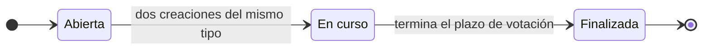

# Una máquina de estados para modelos de Laravel

## Introducción {#intro}

En [Talent Battles](https://talentbattles.com) dos creaciones (dos beats, dos portadas...) se enfrentan en una batalla, y la gente vota cuál le gusta más. Cada batalla pasa por tres estados:

- **Abierta**: tiene una creación y espera a su rival.
- **En curso**: ya tiene sus dos creaciones y se puede votar.
- **Finalizada**: la votación ha terminado y hay un ganador, o un empate.



Parece poca cosa, pero cada cambio tiene sus reglas y sus consecuencias:

- Solo se avanza. Una batalla finalizada no vuelve a estar en curso, y una abierta no puede finalizar sin haber estado en curso.
- Para empezar, la batalla necesita al menos dos creaciones, y todas del mismo tipo: un beat no se enfrenta a un sample.
- Al empezar, se avisa a los participantes.
- Al finalizar, se elige al ganador, se reparten puntos, se actualiza la puntuación de cada participante, se crea una actividad y se avisa a todos.

En este tutorial voy a explicar la pequeña máquina de estados que se encarga de todo eso: un enum, una clase de unas 80 líneas, un trait para el modelo y los eventos de Laravel.

### El porqué de este tutorial

Lo más directo es cambiar el campo allí donde haga falta:

```php
$battle->update(['battle_state' => 'finished']);
```

Funciona, pero cada sitio que lo hace tiene que acordarse de comprobar que la batalla estaba en curso y que tiene dos creaciones, y de lanzar todo lo que pasa después. En Talent Battles hay tres sitios que cambian el estado de una batalla: el servicio que las crea, el matchmaking y el job que las finaliza. Basta con que uno se olvide de algo para tener una batalla finalizada sin ganador.

Con una máquina de estados, todos llaman al mismo método:

```php
$battle->changeState(BattleStates::FINISHED);
```

Y las reglas viven en un solo sitio: qué cambios se permiten, qué hay que validar antes y qué pasa después.

> [!NOTE]
> Hay paquetes que hacen esto, como [spatie/laravel-model-states](https://github.com/spatie/laravel-model-states), que usa una clase por estado. Para tres estados y dos transiciones, prefería algo pequeño que se pudiera leer de arriba abajo en un par de minutos.

## Requisitos {#requirements}

- [Laravel](https://laravel.com/). Uso Laravel 13 con PHP 8.4.
- PHP 8.1 o superior, por los enums y las propiedades `readonly`.

Nada más: ni paquetes ni tablas nuevas. El estado es una columna de texto del propio modelo.

## Las piezas {#pieces}

| Pieza | Qué hace |
| :- | :- |
| `BattleStates` | Enum con los estados posibles |
| `StateMachine` | Clase abstracta que aplica las reglas: comprueba, valida, guarda y ejecuta los hooks |
| `BattleStateMachine` | Las reglas de las batallas |
| `HasStateMachine` | Trait que le da al modelo el método `changeState()` |
| `BattleInProgress` y `BattleFinished` | Eventos que se lanzan al llegar a cada estado, con sus listeners |

`StateMachine` y `HasStateMachine` no saben nada de batallas, así que sirven para cualquier modelo.

## Los estados {#states}

Los estados son un enum respaldado por strings:

```php title="app/Enums/BattleStates.php"
<?php

namespace App\Enums;

enum BattleStates: string
{
    case OPEN = 'open';
    case IN_PROGRESS = 'in_progress';
    case FINISHED = 'finished';
}
```

En la base de datos es un string normal, con el estado inicial por defecto:

```php title="database/migrations/2020_10_02_133047_create_battles_table.php"
$table->string('battle_state')->default(BattleStates::OPEN->value);
```

Y el modelo lo convierte al enum con un cast. Así `$battle->battle_state` es siempre un `BattleStates`, nunca un string suelto:

```php title="app/Models/Battle.php"
protected $casts = [
    'battle_state' => BattleStates::class,
    'battle_type' => BattleTypes::class,
    'won_by' => 'int',
];
```

> [!TIP]
> Con una columna `string` en lugar de un `enum` de MySQL, añadir un estado no necesita migración: basta con un `case` más en el enum.

## La máquina de estados base {#base}

Esta es la clase de la que heredan todas las máquinas:

```php title="app/StateMachines/StateMachine.php"
<?php

namespace App\StateMachines;

use App\Exceptions\TransitionNotAllowedException;
use BackedEnum;
use Illuminate\Contracts\Validation\Validator;
use Illuminate\Database\Eloquent\Model;
use Illuminate\Validation\ValidationException;

use function Illuminate\Support\enum_value;

abstract class StateMachine
{
    public function __construct(public readonly string $field, public readonly Model $model) {}

    /**
     * Allowed transitions, keyed by the state they start from.
     *
     * @return array<string, array<int, string>>
     */
    abstract public function transitions(): array;

    /**
     * Validator that must pass before the transition happens.
     *
     * @param  string  $from
     * @param  string  $to
     * @param  Model  $model
     */
    public function validatorForTransition($from, $to, $model): ?Validator
    {
        return null;
    }

    /**
     * Callbacks to run once the model has been saved, keyed by the state reached.
     *
     * @return array<string, array<int, callable>>
     */
    public function afterTransitionHooks(): array
    {
        return [];
    }

    public function canBe(string $from, string $to): bool
    {
        return in_array($to, $this->transitions()[$from] ?? [], true);
    }

    /**
     * The field may be cast to a backed enum: transitions, validators and hooks work with its value.
     *
     * @throws TransitionNotAllowedException
     * @throws ValidationException
     */
    public function transitionTo(string|BackedEnum $to): void
    {
        $from = enum_value($this->model->{$this->field});
        $to = enum_value($to);

        if ($to === $from) {
            return;
        }

        if (! $this->canBe($from, $to)) {
            throw new TransitionNotAllowedException($from, $to, $this->model::class);
        }

        $validator = $this->validatorForTransition($from, $to, $this->model);

        if ($validator?->fails()) {
            throw new ValidationException($validator);
        }

        $this->model->{$this->field} = $to;
        $this->model->save();

        foreach ($this->afterTransitionHooks()[$to] ?? [] as $hook) {
            $hook($from, $this->model);
        }
    }
}
```

Cada máquina responde a tres preguntas:

- **`transitions()`**: a qué estados se puede ir desde cada uno. Es una lista blanca: lo que no aparece no se permite.
- **`validatorForTransition()`**: qué tiene que cumplir el modelo antes de cambiar. Devuelve un `Validator` de Laravel, o `null` si no hay nada que comprobar.
- **`afterTransitionHooks()`**: qué hay que hacer al llegar a un estado, una vez guardado.

Las dos últimas tienen una versión por defecto que no hace nada, así que a una máquina sencilla le basta con definir sus transiciones.

### El orden de transitionTo()

Lo importante de `transitionTo()` es el orden en que hace las cosas:

1. Si el modelo ya está en ese estado, no hace nada. Así se puede llamar dos veces sin riesgo.
2. Si la transición no está en la lista, lanza `TransitionNotAllowedException`.
3. Si el validador falla, lanza una `ValidationException`, la misma que la de un formulario.
4. Guarda el estado nuevo.
5. Ejecuta los hooks del estado al que ha llegado.

Hasta el paso 4 no se guarda nada, así que una transición rechazada deja la base de datos como estaba. Y como los hooks van después de guardar, ven el estado nuevo: si un listener vuelve a leer la batalla, ya la encuentra finalizada.

> [!NOTE]
> Las claves de un array en PHP solo pueden ser enteros o strings, no enums. Por eso `transitions()` usa `->value`, y `transitionTo()` pasa los dos estados por `enum_value()` de Laravel, que recibe un enum o un string y devuelve siempre el string. Si tu versión de Laravel no lo tiene, `$value instanceof BackedEnum ? $value->value : $value` hace lo mismo.

La excepción de una transición no permitida guarda el estado de origen, el de destino y la clase del modelo, por si quien la captura quiere algo más concreto que el mensaje:

```php title="app/Exceptions/TransitionNotAllowedException.php"
<?php

namespace App\Exceptions;

use Exception;

class TransitionNotAllowedException extends Exception
{
    public function __construct(public readonly string $from, public readonly string $to, public readonly string $model)
    {
        parent::__construct("Transition from [$from] to [$to] is not allowed on [$model].");
    }
}
```

## Las reglas de las batallas {#battle-rules}

Con la base hecha, la máquina de las batallas solo tiene que rellenar los tres métodos:

```php title="app/StateMachines/BattleStateMachine.php"
<?php

namespace App\StateMachines;

use App\Enums\BattleStates;
use App\Enums\BattleTypes;
use App\Events\BattleFinished;
use App\Events\BattleInProgress;
use App\Models\Battle;
use App\Models\Design;
use App\Models\Track;
use Illuminate\Support\Facades\Validator;
use Illuminate\Validation\Rule;

class BattleStateMachine extends StateMachine
{
    public function transitions(): array
    {
        return [
            BattleStates::OPEN->value => [
                BattleStates::IN_PROGRESS->value,
            ],
            BattleStates::IN_PROGRESS->value => [
                BattleStates::FINISHED->value,
            ],
        ];
    }

    /**
     * @param  string  $from
     * @param  string  $to
     * @param  Battle  $model
     */
    public function validatorForTransition($from, $to, $model): ?\Illuminate\Contracts\Validation\Validator
    {
        if ($model->battle_type === BattleTypes::TRACK) {
            $creationIds = $model->tracks->modelKeys();
        } else {
            $creationIds = $model->designs->modelKeys();
        }

        if ($to === BattleStates::IN_PROGRESS->value) {
            if ($model->battle_type === BattleTypes::TRACK) {
                $trackType = Track::find($creationIds[0])->track_type;
                $existsRule = Rule::exists('tracks', 'id')->where('track_type', $trackType->value);
            } else {
                $designType = Design::find($creationIds[0])->design_type;
                $existsRule = Rule::exists('designs', 'id')->where('design_type', $designType->value);
            }

            return Validator::make([
                'creation_ids' => $creationIds,
            ], [
                'creation_ids' => ['array', 'required', 'min:2'],
                'creation_ids.*' => ['required', 'int', $existsRule],
            ]);
        }

        if ($to === BattleStates::FINISHED->value) {
            return Validator::make([
                'creation_ids' => $creationIds,
            ], [
                'creation_ids' => ['array', 'required', 'size:2'],
            ]);
        }

        return null;
    }

    public function afterTransitionHooks(): array
    {
        return [
            BattleStates::IN_PROGRESS->value => [
                function ($from, Battle $battle) {
                    BattleInProgress::dispatch($battle);
                },
            ],
            BattleStates::FINISHED->value => [
                function ($from, Battle $battle) {
                    BattleFinished::dispatch($battle);
                },
            ],
        ];
    }
}
```

### Transiciones

Solo hay dos: de abierta a en curso, y de en curso a finalizada. Desde `finished` no sale ninguna, así que una batalla finalizada ya no cambia.

### Validación

Para empezar (`in_progress`), la batalla necesita al menos dos creaciones (`min:2`), y todas tienen que existir y ser del mismo tipo que la primera. De eso se encarga `Rule::exists()` con un `where()`: comprueba en la base de datos que cada id está en `tracks` con ese `track_type`. Un beat contra un sample no pasa.

Para finalizar, tiene que tener exactamente dos (`size:2`).

Usar el `Validator` de Laravel tiene dos ventajas: reutilizo reglas que ya conozco, y el error es una `ValidationException` con sus mensajes traducidos, igual que en un formulario.

> [!TIP]
> Lo que se comprueba siempre, como que el título no esté vacío, sigue en el `FormRequest` de siempre. El validador de la transición es para lo que solo importa al cambiar de estado.

### Hooks

Al llegar a cada estado, el hook lanza un evento de Laravel. La máquina no sabe qué pasa después: de eso se encargan los listeners, que explico en [Lo que pasa al cambiar de estado](#events).

Cada hook recibe el estado de origen y el modelo. Aquí el origen no hace falta, porque a cada estado solo se llega desde otro, pero sirve si un estado tiene varias entradas.

## Conectar la máquina con el modelo {#model}

El modelo usa el trait `HasStateMachine` e indica qué máquina controla cada campo:

```php title="app/Models/Battle.php"
class Battle extends Model implements HasCommentsInterface, HasCreatedByInterface, HasFavoritesInterface, HasLikesInterface
{
    /** @use HasFactory<BattleFactory> */
    use Commentable,
        Favoritable,
        HasCreatedBy,
        HasFactory,
        HasStateMachine,
        IsFilterable,
        Likeable;

    // ...

    /**
     * @var array<string, class-string<StateMachine>>
     */
    public array $stateMachines = [
        'battle_state' => BattleStateMachine::class,
    ];
```

Y el trait le añade `changeState()`:

```php title="app/Traits/HasStateMachine.php"
<?php

namespace App\Traits;

use App\Exceptions\TransitionNotAllowedException;
use BackedEnum;
use Exception;
use Illuminate\Auth\Access\AuthorizationException;
use Illuminate\Database\Eloquent\Model;

use function Illuminate\Support\enum_value;

/**
 * Trait HasStateMachine
 *
 * @mixin Model
 */
trait HasStateMachine
{
    /**
     * @param  array<string, mixed>  $attributes
     *
     * @throws AuthorizationException
     */
    public function changeState(string|BackedEnum $state, array $attributes = []): Model
    {
        $state = enum_value($state);
        $property = array_keys($this->stateMachines)[0];

        if (empty($this->$property) || $state === enum_value($this->$property)) {
            return $this;
        }

        try {
            if (! empty($attributes)) {
                $this->forceFill($attributes);
            }

            (new $this->stateMachines[$property]($property, $this))->transitionTo($state);
        } catch (Exception $exception) {
            if ($exception instanceof TransitionNotAllowedException) {
                throw new AuthorizationException(trans('exceptions.illegal_transition', [
                    'from' => tConstValue($property, $this->$property),
                    'to' => tConstValue($property, $state),
                ]));
            }

            throw $exception;
        }

        return $this->fresh();
    }
}
```

Paso a paso:

- Toma la primera máquina de `$stateMachines` y la crea con el nombre del campo y el propio modelo.
- Si el campo está vacío, no hace nada: un modelo sin estado todavía no ha entrado en la máquina.
- `$attributes` rellena otros campos para que se guarden con el estado, en el mismo `save()`.
- Convierte `TransitionNotAllowedException` en `AuthorizationException`. Si la llamada viene de un controlador, Laravel responde con un 403 y un mensaje traducido, sin que el controlador tenga que capturar nada. El resto de excepciones pasan tal cual: una `ValidationException`, por ejemplo, Laravel ya la convierte en un 422 con los errores.
- Devuelve `$this->fresh()`, el modelo recién leído de la base de datos.

El mensaje usa dos traducciones. La frase:

```php title="lang/es/exceptions.php"
'illegal_transition' => 'No se puede pasar de :from a :to',
```

```php title="lang/en/exceptions.php"
'illegal_transition' => 'Cannot go from :from to :to',
```

Y el nombre de cada estado:

```php title="lang/es/constants.php"
'battle_states' => [
    'battle_state' => 'State|States',
    'open' => 'Abierta',
    'in_progress' => 'En Curso',
    'finished' => 'Finalizada',
],
```

`tConstValue()` es un helper del proyecto que convierte el nombre del campo en el grupo de traducciones (`battle_state` pasa a `battle_states`) y busca dentro el estado:

```php title="app/Helpers/globals.php"
function tConstValue(string $constant, string|BackedEnum $value): string
{
    if ($value instanceof BackedEnum) {
        $value = $value->value;
    }

    $constant = Str::of(class_basename($constant))
        ->snake()
        ->plural()
        ->value();

    return trans("constants.$constant.$value");
}
```

Así, intentar finalizar una batalla abierta falla con *"No se puede pasar de Abierta a Finalizada"*.

## Lo que pasa al cambiar de estado {#events}

Los hooks solo lanzan eventos. Lo que pasa después está en los listeners de cada evento:

```php title="app/Providers/EventServiceProvider.php"
BattleInProgress::class => [
    CreateNotification::class,
],
BattleFinished::class => [
    SetBattleWinner::class,
    GiveBattlePoints::class,
    UpdateUserRating::class,
    CreateActivity::class,
    CreateNotification::class,
],
```

Así quedan separadas dos cosas: la máquina decide **cuándo** cambia una batalla, y los listeners **qué** pasa entonces. Para dar una insignia al ganador, por ejemplo, bastaría con añadir un listener, sin tocar la máquina.

Estos listeners no implementan `ShouldQueue`, así que se ejecutan uno detrás de otro, en el orden de la lista, dentro de la misma llamada a `changeState()`. Y el orden importa: `SetBattleWinner` va primero porque los demás necesitan saber quién ha ganado.

```php title="app/Listeners/GiveBattlePoints.php"
public function handle(BattleFinished $event): void
{
    $winner = $event->battle->winner;
    $battle = $event->battle;

    if (! $winner) {
        $this->pointsService->giveDrawPoints($battle);

        return;
    }

    $this->pointsService->givePointsToWinner($battle);
    $this->pointsService->givePointsToVoters($battle);
}
```

El propio evento sabe a quién avisar: su método `notify()` manda `BattleWon` al ganador y `BattleLost` al resto, o `BattleDraw` a todos si hay empate. `CreateNotification` solo llama a ese método, y por eso sirve para cualquier evento.

> [!WARNING]
> El estado se guarda antes de los hooks, y `transitionTo()` no abre ninguna transacción. Si un listener falla a mitad, la batalla queda finalizada aunque falten los puntos o las notificaciones. Si quieres que vaya todo junto, envuelve la llamada en `DB::transaction()`, como hace el matchmaking en el apartado siguiente.

## Usarla {#usage}

Con todo esto, cambiar de estado es una línea. Estos son los tres sitios donde lo hace Talent Battles.

### Al llegar la segunda creación

Cuando alguien sube un track para una batalla, se añade a la primera batalla abierta que encaje. Si con él ya son dos, la batalla empieza:

```php title="app/Services/BattleService.php"
$battle->tracks()->save($track);

if ($battle->tracks()->count() === 2) {
    $this->changeStateToInProgress($battle);
}

return $battle->fresh();
```

```php title="app/Services/BattleService.php"
private function changeStateToInProgress(Battle $battle): void
{
    try {
        $battle->changeState(BattleStates::IN_PROGRESS);
    } catch (Exception $e) {
        Logger::exception($e);

        return;
    }
}
```

Si la transición falla, se registra el error y la batalla sigue abierta. Subir el track no falla por eso.

### En el matchmaking

El matchmaking crea la batalla con sus dos creaciones de una vez, y la empieza dentro de la misma transacción:

```php title="app/Services/MatchmakingService.php"
DB::transaction(function () use ($creation, $opponent, $platformUserId, $settings) {
    $battle = Battle::forceCreate([
        'created_by' => $platformUserId,
        'battle_state' => BattleStates::OPEN,
        'battle_type' => $settings['battle'],
    ]);

    $battle->{$settings['relation']}()->attach([$creation->id, $opponent->id]);

    $battle->changeState(BattleStates::IN_PROGRESS);
});
```

Si la validación falla o un listener lanza una excepción, la transacción se deshace entera y no queda ninguna batalla a medias.

### Al terminar la votación

Un job busca las batallas que llevan en curso más días de los configurados y las finaliza:

```php title="app/Jobs/CheckBattlesToFinish.php"
public function handle(): void
{
    Cache::lock(self::class, 300)->get(function () {
        Battle::areInProgress()
            ->where('created_at', '<=', today()->subDays($this->battleTTL))
            ->orderBy('created_at')
            ->limit(self::BATCH_SIZE)
            ->get()
            ->each(fn (Battle $battle) => $this->finish($battle));
    });
}

/**
 * A battle that cannot finish, like one without two creations, must not stop the others.
 */
private function finish(Battle $battle): void
{
    try {
        $battle->changeState(BattleStates::FINISHED);
    } catch (Exception $exception) {
        Logger::exception($exception);
    }
}
```

Cada batalla tiene su propio `try`, así que una que no puede finalizar no frena a las demás. El lock evita que dos ejecuciones a la vez finalicen la misma batalla dos veces, aunque la máquina ya lo pondría difícil: la segunda vez, la batalla ya no estaría en curso.

## Tests {#tests}

Los tests pasan por `changeState()`, igual que el código real, y comprueban el resultado: el estado guardado, las excepciones y lo que hacen los listeners.

En el `setUp()` se crea una batalla abierta con dos beats, y un voto para que el primero vaya ganando. `create()` es un helper del proyecto: `create(User::class, [...])` equivale a `User::factory()->create([...])`.

```php title="tests/Feature/StateMachines/BattleStateMachineTest.php"
protected function setUp(): void
{
    parent::setUp();
    Queue::fake();
    User::flushEventListeners();
    $this->winnerUser = create(User::class, [
        'points' => 0,
    ]);
    $this->battle = create(Battle::class, [
        'battle_type' => BattleTypes::TRACK,
        'battle_state' => BattleStates::OPEN->value,
    ]);
    $this->trackA = create(Track::class, [
        'created_by' => $this->winnerUser->id,
        'track_type' => TrackTypes::BEAT,
    ]);
    $this->trackB = create(Track::class, [
        'created_by' => create(User::class, ['points' => 0])->id,
        'track_type' => TrackTypes::BEAT,
    ]);

    // TrackA is winning
    create(Vote::class, [
        'created_by' => create(User::class)->id,
        'votable_id' => $this->trackA->id,
        'votable_type' => Track::class,
        'value' => 10,
    ]);

    $this->battle->tracks()->saveMany([$this->trackA, $this->trackB]);
}
```

Primero, las reglas: no se puede saltar un estado, repetir el actual no hace nada, una validación fallida no guarda nada, y dos creaciones de tipos distintos no empiezan una batalla:

```php title="tests/Feature/StateMachines/BattleStateMachineTest.php"
#[Test]
public function it_cannot_jump_to_a_state_that_is_not_allowed_from_the_current_one()
{
    $this->expectException(AuthorizationException::class);
    $this->expectExceptionMessage('Cannot go from Open to Finished');

    $this->battle->changeState(BattleStates::FINISHED);
}

#[Test]
public function changing_to_the_current_state_does_nothing()
{
    $this->battle->changeState(BattleStates::OPEN);

    $this->assertSame(BattleStates::OPEN, $this->battle->fresh()->battle_state);
}

#[Test]
public function it_does_not_save_the_state_when_validation_fails()
{
    $this->battle->tracks()->detach($this->trackB);

    try {
        $this->battle->changeState(BattleStates::IN_PROGRESS);
        $this->fail('The transition should have been rejected');
    } catch (ValidationException) {
        $this->assertSame(BattleStates::OPEN, $this->battle->fresh()->battle_state);
    }
}

#[Test]
public function it_wont_transition_track_battle_to_in_progress_from_open_if_tracks_has_different_types()
{
    $this->trackB
        ->forceFill(['track_type' => TrackTypes::SAMPLE])
        ->saveQuietly();

    $this->expectException(ValidationException::class);

    $this->battle->changeState(BattleStates::IN_PROGRESS);
}
```

El primer test comprueba también el mensaje, y lo hace con el texto escrito tal cual, no con `trans()`. Si falta la traducción, `trans()` devuelve la propia clave, y un test que comparara con `trans()` pasaría igual. Los tests se ejecutan con el idioma por defecto del proyecto, el inglés, así que el mensaje es el de `lang/en`.

> [!NOTE]
> El test de la validación usa `try` y `catch` en vez de `expectException()` porque, después de la excepción, quiere comprobar algo más: que en la base de datos la batalla sigue abierta. Con `expectException()`, el test termina en cuanto salta la excepción, y cualquier línea que vaya después no llega a ejecutarse.

Después, lo que pasa al llegar a cada estado. Para tener una batalla en curso sin pasar por la máquina, el test escribe el estado directamente con `forceFill()->saveQuietly()`. Es la preparación del test, no lo que se prueba:

```php title="tests/Feature/StateMachines/BattleStateMachineTest.php"
#[Test]
public function when_transitioning_to_in_progress_it_will_notify_all_participants_except_logged_user()
{
    Notification::fake();

    $this->signIn($this->trackA->createdBy);

    $this->battle->changeState(BattleStates::IN_PROGRESS);

    Notification::assertSentTo($this->trackB->createdBy, function (BattleStarted $notification) {
        return $this->battle->id === $notification->battle->id;
    });
}

#[Test]
public function it_can_transition_track_battle_to_finished_from_in_progress()
{
    $this->battle->forceFill([
        'battle_state' => BattleStates::IN_PROGRESS->value,
    ])->saveQuietly();

    $this->battle->changeState(BattleStates::FINISHED);

    $this->assertEquals(BattleStates::FINISHED, $this->battle->battle_state);
    $this->assertEquals($this->winnerUser->id, $this->battle->won_by);
}

#[Test]
public function when_transitioning_to_finished_it_will_give_points_to_the_winner()
{
    $this->battle->forceFill([
        'battle_state' => BattleStates::IN_PROGRESS->value,
    ])->saveQuietly();

    $this->battle->changeState(BattleStates::FINISHED);

    $this->assertEquals(config('company.points.awards.win_battle'), $this->winnerUser->fresh()->points);
}
```

> [!TIP]
> Estos tests no prueban `StateMachine` por separado, sino a través de una máquina real. Si algún día cambia por dentro (por ejemplo, para añadir una transacción), los tests siguen siendo válidos mientras las batallas se comporten igual.

## Mejoras posibles {#improvements}

- **Una transacción dentro de la máquina.** Si `transitionTo()` envolviera en `DB::transaction()` el `save()` y los hooks, cada cambio de estado sería todo o nada, lo llame quien lo llame. Ojo con lo que sale de la base de datos: un correo o un mensaje en tiempo real que mande un listener no se deshacen si la transacción se revierte.
- **Varias máquinas en un modelo.** El trait usa la primera de `$stateMachines`. Un pedido con un estado de envío y otro de pago necesitaría que `changeState()` recibiera también el campo.
- **Un historial.** Un hook común a todos los estados podría guardar en una tabla quién cambió el estado, desde cuál y cuándo. Si va en `StateMachine`, lo heredan todas las máquinas.

## Código {#code}

Todos los ficheros de la máquina están completos en los apartados anteriores:

| Fichero | Apartado |
| :- | :- |
| `app/Enums/BattleStates.php` | [Los estados](#states) |
| `app/StateMachines/StateMachine.php` | [La máquina de estados base](#base) |
| `app/Exceptions/TransitionNotAllowedException.php` | [La máquina de estados base](#base) |
| `app/StateMachines/BattleStateMachine.php` | [Las reglas de las batallas](#battle-rules) |
| `app/Traits/HasStateMachine.php` | [Conectar la máquina con el modelo](#model) |

¡Y ya está!

Ahora cambiar el estado de una batalla es una sola línea, la llame quien la llame, y las reglas y lo que pasa después están en un solo sitio. Para añadir un estado nuevo, como *cancelada*, basta con un `case` en el enum, una línea en `transitions()` y, si hace falta, un evento con sus listeners.
